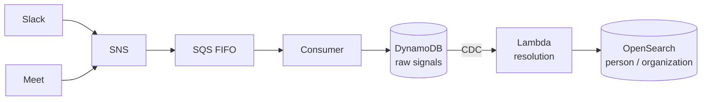
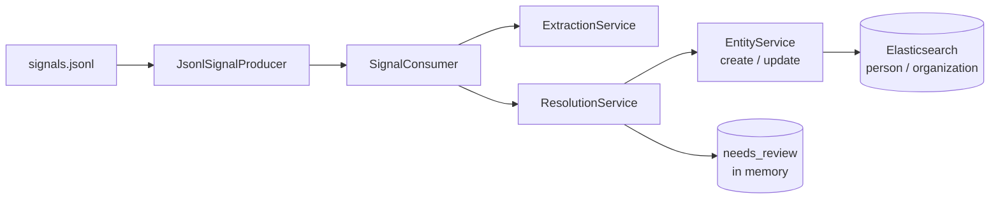

# streaming-entity-resolution

Processes conversation signals (Slack messages and meeting transcripts) one at a time, in
order, as if they were arriving live, and keeps a repository of the **people** and
**organizations** they talk about: who speaks, who attends and who is mentioned. "Jo",
"Joana P." and `joana@example.com` should end up as one entity; two different people must
never be merged.

The sample data in [`data/`](data) belongs to a fictional company, Caravela
([`data/tenant.json`](data/tenant.json)), with 57 signals in
[`data/signals.jsonl`](data/signals.jsonl).

## Quick start

Requirements: Docker, [uv](https://docs.astral.sh/uv/), Node 22 with pnpm (for the UI) and an
OpenAI API key.

```sh
cp .env.example .env      # fill OPENAI_API_KEY
make up                   # Elasticsearch on :9200
make install
make run                  # writes out/entities.json and out/needs_review.json
make check                # validates the critical invariants of the output
```

`make help` lists every target. LLM responses are cached in `.cache/llm/`, so a second
`make run` is fast, free and reproducible; `make run-no-cache` ignores the cache.

## Architecture

The production design this code is shaped after:



What runs locally today, with no simulated AWS infrastructure:



The producer stands in for SNS + SQS FIFO (ordering), the consumer for the queue consumer
and the CDC-triggered Lambda, and `EntityService` for the create/update endpoints. Each
piece can be swapped for its cloud counterpart without touching the resolution logic.

## Pipeline

For each signal, in order:

1. **Structured observations, no LLM.** The author and participants become one person
   observation per email. A speaker inherits a participant's email only when the full
   normalized name is identical. Bots are ignored. Unnamed speakers ("Speaker 3") go to
   review.
2. **LLM extraction, one call per signal.** The model reads the free text (message, or
   meeting title and utterances) with the participants as context and returns the
   people and organizations mentioned, grouped within the signal, plus a short note for
   each participant. A surface the model returns is kept only if it occurs in the signal
   (case and accent insensitive), and the stored surface is the exact original span.
3. **Organizations first, then people**, so a person can be linked to an organization
   created moments earlier in the same signal.
4. **Resolution of each observation:**
   - Exact match: email for a person, email domain for an organization.
   - Otherwise lexical search in Elasticsearch (fuzzy `multi_match` on name and aliases,
     plus an edge n-gram subfield for nicknames), top 5 of the same kind.
   - Candidates that violate a hard guard are dropped.
   - The LLM decides `match`, `new` or `ambiguous`, with a confidence and an updated
     description.
   - A merge needs `match`, confidence of at least 0.85 and a candidate id that was offered.
     Everything else uncertain goes to `needs_review` without creating an entity.
5. After the last signal, the repository is exported.

## API

A read-only API serves the last run to the UI, straight from `data/` and `out/`, so it
works without Elasticsearch running:

```sh
make api   # http://localhost:8000/docs
```

| Route | Returns |
| --- | --- |
| `GET /api/signals` | the signals, in order |
| `GET /api/trace` | one event per resolved observation: candidates, guards, LLM decision, outcome, entity before and after |
| `GET /api/entities` | `out/entities.json` |
| `GET /api/reviews` | `out/needs_review.json` |

A missing run output returns `404` as `application/problem+json` with code `RUN_NOT_FOUND`.

## UI

A read-only replay of the last run, served by the API above:

```sh
make api   # terminal 1
make ui    # terminal 2, http://localhost:5173
```

- **Replay:** steps through the signals in order (0.5x, 1x, 2x), highlights each mention by
  outcome (matched, created, sent to review) and shows the decision trace: exact match,
  search candidates with scores, candidates removed by a guard, the LLM decision and the
  resulting change. The repository panel shows the state right after the selected signal,
  rebuilt in the browser from the trace.
- **Review:** the mentions the pipeline did not attribute, with the reason and the candidates
  it considered. It is a report; manual review is in the [backlog](BACKLOG.md).
- **Entities:** search, identity, how the description changed (revisions), where the entity
  appears, and a "protected homonym" note when a guard actually kept someone apart from it.

## Output

`out/entities.json`:

```json
{
  "id": "e_004",
  "kind": "PERSON",
  "name": "Luiz Barreto",
  "aliases": [],
  "emails": ["luiz.barreto@translog.com.br"],
  "description": "Novo diretor da Translog, quem assina o contrato.",
  "mentions": [{"signal_id": "s_001", "surface": "Luiz Barreto"}],
  "revisions": [{"signal_id": "s_001", "name": "Luiz Barreto", "description": "..."}]
}
```

- `mentions`: every place the entity appears, with the surface exactly as written in the
  signal (text, title, author, participant or speaker).
- `description`: what the entity is to the tenant company now.
- `revisions`: one entry per signal that changed the name or the description.

`out/trace.jsonl`: the decision trace, one JSON event per resolved observation.

`out/needs_review.json`: the mentions that could not be attributed, with `signal_id`,
`surface` and `reason`.

## Decisions

- **Splitting is cheap, merging is expensive.** Every uncertain path ends in review, never
  in a merge or a new entity.
- **Two hard guards only:** different non-empty emails, and different `org_id`s. The
  `org_id` guard applies only to the search + LLM path; an exact email match overrides it,
  so a person who changes companies is updated instead of blocked.
- **Domain resolves organizations, not people.** For a person, the email domain only sets
  the organization. When the LLM links a participant's domain to an organization, the
  domain is stored on it, and the next email from that domain resolves without the LLM.
- **An ambiguous decision about someone with an email creates a new entity.** The email is
  a strong identity of its own, and splitting is the cheap error: "Rafael Teixeira", author
  with an email, no longer goes to review just because a nickname-only "Rafa" exists.
  Without an email, ambiguous still goes to review.
- **Aliases drop a leading article** ("O Carlos" is stored as the alias "Carlos"); the
  mention keeps the exact surface from the signal.
- **Anchor rule:** a new person needs an email, a name with two or more tokens, an
  organization or a role. A bare first name with nothing else goes to review.
- **Name upgrade:** the name changes only when each token of the current name is a prefix
  of a token of the new one ("Jo" to "Joana Prates", "Carlos M." to "Carlos Menezes").
  Otherwise the new form becomes an alias ("Bia" and "Beatriz" stay apart as name and
  alias).
- **Revisions:** creation always writes one; an update writes one only when the name or
  the description changed. The seeded tenant organization has no revision, since it does
  not come from a signal.
- **Match threshold of 0.85, applied to the LLM confidence, not to the search score.**
  The Elasticsearch BM25 score is not normalized across queries: in the first run the top
  candidate scored between 4.2 and 40.2 when the decision was a match, and between 2.7 and
  29.1 when it was ambiguous, so no cut on it separates the two. It is only used to rank
  candidates, and the chosen one was the first in 83 of 86 matches. The LLM confidence is
  not continuous either: the model answered in a few round values (0.95 in 31 matches, 0.9
  in 42, 0.85 in 3, 0.8 in 4, 0.7 to 0.75 in 3), so it behaves like categories. 0.85 cuts
  between the "near certain" and "probably" groups. The three matches accepted exactly at
  0.85 were correct; of the seven rejected below it, most look right on inspection, but
  that is a handful of unlabeled cases and wrongly merging two people costs more than one
  more review item, so the threshold stays conservative. How to recalibrate it on labeled
  boundary cases is described in the [backlog](BACKLOG.md#threshold-calibration-on-real-boundary-cases).
- **Lexical search first.** Freshly created entities have one-line descriptions, so
  embeddings would add little at first. kNN comes next; `more_like_this` was discarded
  because names are too short for term statistics.
- **Writes use `refresh=true`,** so a document saved earlier in the same signal is visible
  to the next search (an organization created in a signal must be found when a person of
  that signal is resolved). `wait_for` gives the same guarantee but blocks each write until
  the next scheduled refresh (1 s by default); forcing the refresh costs nothing at this
  volume. In production, with many writes, forcing a refresh per document would be too
  expensive: refresh once per batch, or keep an in-memory cache of the entities touched in
  the current signal and search it alongside the index.
- **Models:** extraction and decision models are configured separately
  (`EXTRACTION_MODEL`, `DECISION_MODEL`, default `gpt-5-mini`) with low reasoning effort.
  The GPT-5 family does not take `temperature`, so reruns are made deterministic by the
  disk cache, keyed by model, reasoning effort, prompts and schema.
- **Elasticsearch is the source of truth** and is recreated on every run. Review items are
  kept in memory because nothing reads them during processing.

## Next steps

See [BACKLOG.md](BACKLOG.md).

## Development

See [AGENTS.md](AGENTS.md) for commands, layers and code rules.
