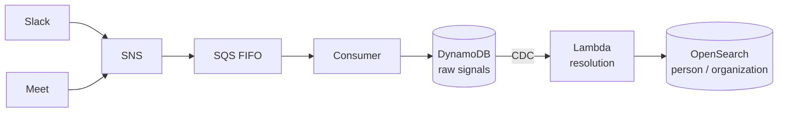
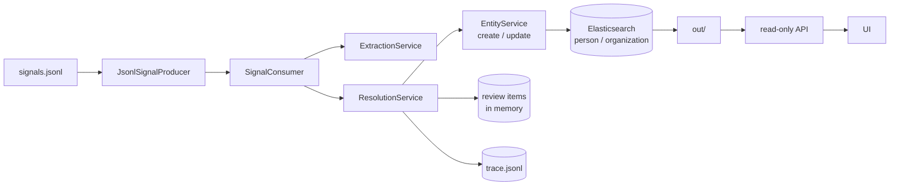
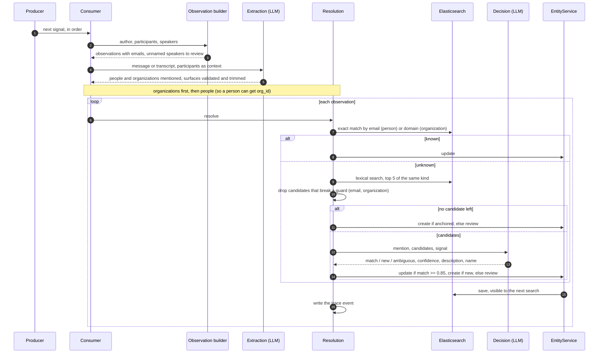

# streaming-entity-resolution

Reads a company's conversations (Slack messages and meeting transcripts) **one signal at a
time, in order, as if they were arriving live**, and keeps a single repository of the
**people** and **organizations** they talk about: who speaks, who attends and who is
mentioned.

"Jo", "Joana P." and `joana@example.com` should end up as one entity. Two different people
must never be merged: when the pipeline cannot tell who a mention refers to, it sends it to
review instead of guessing.

The sample data in [`data/`](data) belongs to a fictional company, Caravela
([`tenant.json`](data/tenant.json)), with 57 signals in
[`signals.jsonl`](data/signals.jsonl). It includes the hard cases: nicknames, misheard
names in transcripts, unnamed speakers, and three pairs of different people sharing a first
name.

## What you need

| Tool | Used for |
| --- | --- |
| [Docker](https://docs.docker.com/get-docker/) with Compose | Elasticsearch, the entity store |
| [uv](https://docs.astral.sh/uv/) | Python 3.12 and its dependencies |
| An OpenAI API key | entity extraction and match decisions |
| Node 22 and [pnpm](https://pnpm.io/) | the UI only |

## Quick start

```sh
cp .env.example .env      # set OPENAI_API_KEY
make up                   # start Elasticsearch on :9200
make install              # install Python dependencies
make run                  # process the signals, write out/
make check                # validate the critical invariants of the output
```

Then, to explore the run in the browser:

```sh
make api                  # terminal 1: read-only API on :8000
make ui                   # terminal 2: http://localhost:5173
```

LLM responses are cached in `.cache/llm/`: a second `make run` is fast, free and identical.
`make run-no-cache` ignores the cache. `make help` lists every target. Tests are described
in [Tests and CI](#tests-and-ci).

## Output

| File | Content |
| --- | --- |
| `out/entities.json` | the repository after the last signal |
| `out/needs_review.json` | mentions that could not be attributed, with `signal_id`, `surface` and `reason` |
| `out/trace.jsonl` | one event per resolved observation: candidates, guards, LLM decision, outcome, entity before and after |

An entity from the sample run (lists shortened):

```json
{
  "id": "e_005",
  "kind": "PERSON",
  "name": "Luiz Barreto",
  "aliases": [
    "luís",
    "Luiz"
  ],
  "emails": [
    "luiz.barreto@translog.com.br"
  ],
  "description": "Luiz Barreto — Diretor na Translog envolvido na expansão; agora confirmado como o contato que enviou o contrato assinado para as 3 filiais novas.",
  "mentions": [
    {
      "signal_id": "s_001",
      "surface": "Luiz Barreto"
    },
    {
      "signal_id": "s_021",
      "surface": "Luiz Barreto"
    },
    {
      "signal_id": "s_021",
      "surface": "luís"
    },
    {
      "signal_id": "...",
      "surface": "..."
    }
  ],
  "revisions": [
    {
      "signal_id": "s_001",
      "name": "Luiz Barreto",
      "description": "Novo diretor na Translog — agora é quem assina contratos (decisor)"
    },
    {
      "signal_id": "...",
      "name": "...",
      "description": "..."
    }
  ]
}
```

- `mentions`: every place the entity appears, with the surface exactly as written in the
  signal (text, title, author, participant or speaker).
- `description`: what the entity is to the company now.
- `revisions`: one entry per signal that changed the name or the description.

## Architecture

The production design the code is shaped after:



What runs locally, with no simulated AWS infrastructure:



The producer stands in for SNS + SQS FIFO (ordering), the consumer for the queue consumer
and the CDC-triggered Lambda, and `EntityService` for the create and update endpoints. Each
piece can be replaced by its cloud counterpart without touching the resolution logic.

## Pipeline

What happens to one signal:



After the last signal, the repository, the review items and the trace are exported to
`out/`. The reasons behind each rule are in [docs/decisions.md](docs/decisions.md).

## Code map

```text
.
├── data/                  input signals and tenant (never edited)
├── src/app/
│   ├── main.py            pipeline entry point: reset, seed, consume every signal, export
│   ├── check.py           `make check`: homonyms apart, Expresso Norte/Nordeste apart, unique emails
│   ├── config.py          settings from env and .env (models, threshold, paths, URLs)
│   ├── api.py             read-only FastAPI app over data/ and out/
│   ├── openapi_dump.py    writes openapi.json, the contract the UI types are generated from
│   ├── dependencies.py    FastAPI dependency wiring
│   ├── errors.py          errors as application/problem+json
│   ├── producers/         where signals come from
│   │   ├── signal_producer.py        SignalProducer protocol
│   │   └── jsonl_signal_producer.py  reads signals.jsonl in order, rejects out-of-order input
│   ├── consumers/
│   │   └── signal_consumer.py        one signal: observations, extraction, orgs then people
│   ├── services/          business rules
│   │   ├── normalization.py          case/accent folding, tokens, domains, surface span and trimming
│   │   ├── decision_rules.py         guards, threshold, anchor, name upgrade, canonical org name
│   │   ├── observation_builder.py    observations from author/participants/speakers; signal rendering
│   │   ├── extraction_service.py     LLM extraction, surface validation
│   │   ├── resolution_service.py     exact match, search, guards, LLM decision, trace
│   │   ├── entity_service.py         create, update and seed (the "endpoints")
│   │   ├── prompts.py                extraction and decision prompts
│   │   └── export_service.py         writes entities.json and needs_review.json
│   ├── repositories/      storage behind protocols
│   │   ├── entity_repository.py      EntityRepository protocol
│   │   ├── elastic_entity_repository.py  Elasticsearch implementation and search query
│   │   ├── index_mappings.py         analyzers (folding, edge n-gram) and field mappings
│   │   ├── review_repository.py      ReviewRepository protocol
│   │   ├── memory_review_repository.py  in-memory review items
│   │   ├── trace_recorder.py         TraceRecorder protocol and JSONL writer
│   │   └── run_files.py              reads the run output for the API
│   ├── clients/           external services
│   │   ├── llm_client.py             LLMClient protocol
│   │   ├── openai_client.py          structured outputs and embeddings, through the cache
│   │   ├── disk_cache.py             response cache keyed by sha256
│   │   └── elastic_client.py         Elasticsearch client from settings
│   ├── handlers/
│   │   └── run.py                    GET /api/signals, /api/trace, /api/entities, /api/reviews
│   └── types/             Pydantic models shared by every layer
│       ├── signal.py                 Signal, Contact, Utterance, Tenant
│       ├── entity.py                 Entity, Mention, Revision, SearchHit, EntityExport
│       ├── observation.py            LLM extraction schema and Observation
│       ├── decision.py               CandidateDecision, ReviewItem
│       └── trace.py                  TraceEvent
├── tests/
│   ├── unit/              normalization, decision rules, OpenAI client and cache, API
│   └── integration/       Elasticsearch repository (needs `make up`)
├── frontend/              React UI (Vite, TanStack Query)
│   └── src/
│       ├── api/           one query hook per endpoint, generated types (schema.gen.ts)
│       ├── logic/         pure, tested logic: repository state at a signal, highlights, event choice
│       ├── components/    signal list, trace panel, repository panel, replay controls
│       └── pages/         Replay, Review, Entities, Entity
├── docs/                  decisions and backlog
├── compose.yaml           Elasticsearch
├── Makefile               every command
└── AGENTS.md              commands and code rules for coding agents
```

Dependencies point one way: `producers -> consumers -> services -> repositories / clients`,
with `types` shared by all.

## API

| Route | Returns |
| --- | --- |
| `GET /api/signals` | the signals, in order |
| `GET /api/trace` | the decision trace |
| `GET /api/entities` | `out/entities.json` |
| `GET /api/reviews` | `out/needs_review.json` |

A missing run output returns `404` as `application/problem+json` with code `RUN_NOT_FOUND`.
Interactive docs at `http://127.0.0.1:8000/docs`.

## UI

- **Replay:** steps through the signals (0.5x, 1x, 2x), highlights each mention by outcome
  (matched, created, sent to review) and shows the decision trace: exact match, search
  candidates with scores, candidates removed by a guard, the LLM decision and the resulting
  change. The repository panel shows the state right after the selected signal.
- **Review:** the mentions the pipeline did not attribute, with the reason and the
  candidates it considered. A report, not a work queue.
- **Entities:** search, identity, how the description changed, where the entity appears,
  and a "protected homonym" note when a guard actually kept someone apart from it.

A step-by-step example with screenshots is in [docs/walkthrough.md](docs/walkthrough.md).

## Tests and CI

| Layer | Framework | What it covers | In CI |
| --- | --- | --- | --- |
| Backend unit (56) | [pytest](https://docs.pytest.org/) | normalization and surface trimming (18), decision rules: guards, threshold, anchor, name upgrade, canonical organization name (29), OpenAI client and disk cache with hand-written fakes (7), API routes with FastAPI's `TestClient` (2) | yes |
| Backend integration (11) | pytest against a real Elasticsearch | the repository: mappings, exact lookups, fuzzy and prefix search, accent folding, kinds kept apart; skipped when Elasticsearch is not running | no |
| Frontend unit (17) | [Vitest](https://vitest.dev/) | the pure logic: repository state at a signal, highlight segmentation (longest first, no overlap), default trace event | yes |
| Invariants | `make check` on a real run | homonyms never merged, Expresso Norte and Nordeste apart, no email in two entities | no, needs an OpenAI key |
| End to end | none yet | a browser test of the UI over a recorded run is in the [backlog](docs/backlog.md) | no |

Unit tests come first where an error is expensive: normalization and the decision rules
were written test first. They never call the LLM or Elasticsearch.

Static checks: [ruff](https://docs.astral.sh/ruff/) (lint and format) and mypy strict
(non-blocking for now) on the backend; ESLint with typed rules, Prettier and `tsc` on the
frontend.

```sh
make test                                 # backend unit tests
make lint                                 # ruff, format check, mypy (non-blocking)
uv run pytest tests/integration           # needs `make up`
cd frontend && pnpm install && pnpm test  # frontend unit tests
make run && make check                    # invariants on a real run
```

[GitHub Actions](.github/workflows/ci.yaml) runs on every pull request and push to `main`:

- **backend:** `uv sync --frozen`, ruff check, ruff format check, unit tests, and a check
  that `openapi.json` matches the API (the UI types are generated from it).
- **frontend:** `pnpm install --frozen-lockfile`, lint, typecheck, unit tests, build.

## Further reading

- [docs/walkthrough.md](docs/walkthrough.md): four signals in a row, with screenshots of what
  the pipeline captured and changed in each.
- [docs/decisions.md](docs/decisions.md): why each rule is the way it is.
- [docs/backlog.md](docs/backlog.md): what was left out, and why.
- [AGENTS.md](AGENTS.md): commands, layers and code rules for contributors.
