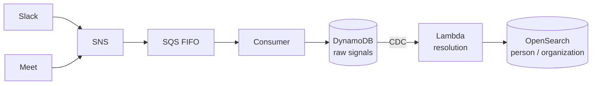
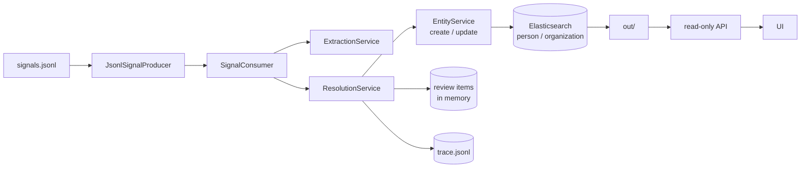
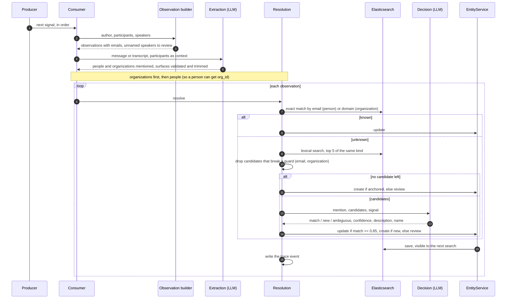

# streaming-entity-resolution

A small system that reads a company's conversations, **one message at a time, in the order
they happened**, and keeps a single, clean record of every **person** and **organization**
they talk about.


[Watch the 6-minute demo video](https://www.youtube.com/watch?v=ycPjflzUv3A): the problem,
the architecture, the code that matters, and a replay of a real run in the UI.

## What it does

In a company's Slack messages and meeting transcripts, the same person shows up in many
forms: "Jo" in one message, "Joana P." in another, only `joana@example.com` in a third. This
project figures out that they are one person and keeps one record for her, updating it as new
messages arrive.

One rule comes before everything else: **never merge two different people.** When the system
is not sure who a name refers to, it does not guess; it puts the name on a review list for a
human.

The sample data in [`data/`](data) comes from a fictional company, Caravela: 57 messages and
meetings in [`signals.jsonl`](data/signals.jsonl), with the hard cases on purpose (nicknames,
names misheard by transcription, unnamed speakers, and three pairs of different people who
share a first name).

### Key terms

| Term | Meaning |
| --- | --- |
| **Signal** | One Slack message or one meeting transcript. Signals are processed in order. |
| **Entity** | The record of one person or one organization. |
| **Mention** | A name found in a signal, exactly as written ("Pedro", "trans log", "Speaker 3"). |
| **Candidate** | An existing entity that a mention might refer to, found by search. |
| **Guard** | A fixed rule that removes a candidate that cannot be the same person (different email, different organization). |
| **Threshold** | The minimum confidence (0.85) the language model must give before a mention is joined to a candidate. |
| **Review list** | Mentions the system did not attribute, left for a human. |
| **Trace** | A log of every decision, used by the UI to replay the run. |

## Quick start

You need [Docker](https://docs.docker.com/get-docker/) with Compose (for Elasticsearch),
[uv](https://docs.astral.sh/uv/) (Python 3.12), an OpenAI API key, and Node 22 with
[pnpm](https://pnpm.io/) for the UI.

```sh
cp .env.example .env      # set OPENAI_API_KEY
make up                   # start Elasticsearch on :9200
make install              # install Python dependencies
make run                  # process the 57 signals and write out/
make check                # confirm no two people were merged
```

Explore the run in the browser:

```sh
make api                  # terminal 1: read-only API on :8000
make ui                   # terminal 2: open http://localhost:5173
```

Language model answers are cached in `.cache/llm/`, so running `make run` again is fast, free
and gives the same result. `make help` lists every command.

## How it works

### Architecture

The code is shaped after this production design:



Locally the same roles run as plain Python in one loop, with no simulated cloud:



| Local piece | Plays the role of | Does |
| --- | --- | --- |
| `JsonlSignalProducer` | SNS + SQS FIFO | delivers signals one at a time, in order |
| `SignalConsumer` | queue consumer + Lambda | finds the mentions in a signal and resolves them |
| `EntityService` | create and update endpoints | writes entities to Elasticsearch |
| Elasticsearch | OpenSearch | stores and searches entities |

Each piece can be swapped for its cloud counterpart without touching the resolution logic.

### Resolving a mention

For every signal, the system first lists the mentions. People who wrote or attended come
from the message fields, with their emails. Names inside the text are found by a language
model. Organizations are resolved before people, so a person can be linked to their
organization. Then each mention goes through four steps:

1. **Exact match.** A known email (person) or email domain (organization) finds the entity
   right away, without search or language model.
2. **Search.** Elasticsearch looks for entities with a similar name (typos, accents and
   nicknames included) and keeps the five best as candidates.
3. **Guards.** Candidates with a different email, or from a different organization, are
   removed.
4. **Decision.** A language model reads the signal and the remaining candidates and answers
   "it is this one", "it is someone new" or "not clear", with a confidence from 0 to 1. The
   mention is joined to the candidate only if the answer is a match with confidence of at
   least 0.85. A new person is created only if there is something to anchor them (an email,
   a full name, an organization or a role). Everything else goes to the review list.

The same flow as a sequence diagram:



Why each rule is the way it is, with numbers from the sample run, is in
[docs/decisions.md](docs/decisions.md).

## Output

After the last signal, `make run` writes three files to `out/`:

| File | Content |
| --- | --- |
| `entities.json` | every entity, as it stands after the last signal |
| `needs_review.json` | the review list: `signal_id`, `surface` and `reason` for each mention |
| `trace.jsonl` | one event per decision: candidates, guards, model answer, outcome, entity before and after |

One entity from the sample run, shortened:

```json
{
  "id": "e_005",
  "kind": "PERSON",
  "name": "Luiz Barreto",
  "aliases": ["luís", "Luiz"],
  "emails": ["luiz.barreto@translog.com.br"],
  "description": "Luiz Barreto — Diretor na Translog envolvido na expansão; ...",
  "mentions": [
    {"signal_id": "s_001", "surface": "Luiz Barreto"},
    {"signal_id": "s_021", "surface": "luís"}
  ],
  "revisions": [
    {"signal_id": "s_001", "name": "Luiz Barreto", "description": "Novo diretor na Translog — ..."}
  ]
}
```

- `aliases`: other names this entity was called.
- `mentions`: every place the entity appears, with the exact text from the signal.
- `description`: what the entity is to the company now.
- `revisions`: one entry for each signal that changed the name or the description.

## The UI

A read-only web app that replays the last run (shown in the
[demo video](https://www.youtube.com/watch?v=ycPjflzUv3A)):

- **Replay:** goes through the signals in order (0.5x, 1x, 2x). Each name is colored by what
  happened to it: green, joined to an existing entity; blue, a new entity; orange, sent to
  review. The middle panel shows the four steps for one mention, and the right panel shows
  all entities as they stood right after that signal.
- **Review:** every mention the system did not attribute, with the reason and the candidates
  it considered.
- **Entities:** a page per entity with its emails, aliases, every mention, how the
  description changed, and a "protected homonym" note when a guard kept another person apart.

The API behind it only reads `data/` and `out/`, so it works without Elasticsearch running:

| Route | Returns |
| --- | --- |
| `GET /api/signals` | the signals, in order |
| `GET /api/trace` | the decision trace |
| `GET /api/entities` | `out/entities.json` |
| `GET /api/reviews` | `out/needs_review.json` |

If the run output is missing, it returns `404` as `application/problem+json` with code
`RUN_NOT_FOUND`. Interactive docs: `http://127.0.0.1:8000/docs`.

## Code map

Dependencies point one way: `producers -> consumers -> services -> repositories / clients`,
with `types` shared by all. The rules that decide a merge live in two files:
`services/decision_rules.py` and `services/normalization.py`.

```text
.
├── data/                  input signals and tenant (never edited)
├── src/app/
│   ├── main.py            pipeline entry point: reset, seed, consume every signal, export
│   ├── check.py           `make check`: homonyms apart, Expresso Norte/Nordeste apart, unique emails
│   ├── config.py          settings from env and .env (models, threshold, paths, URLs)
│   ├── api.py             read-only FastAPI app over data/ and out/
│   ├── openapi_dump.py    writes openapi.json, the contract the UI types are generated from
│   ├── dependencies.py    FastAPI dependency wiring
│   ├── errors.py          errors as application/problem+json
│   ├── producers/         where signals come from
│   │   ├── signal_producer.py        SignalProducer protocol
│   │   └── jsonl_signal_producer.py  reads signals.jsonl in order, rejects out-of-order input
│   ├── consumers/
│   │   └── signal_consumer.py        one signal: observations, extraction, orgs then people
│   ├── services/          business rules
│   │   ├── normalization.py          case/accent folding, tokens, domains, surface span and trimming
│   │   ├── decision_rules.py         guards, threshold, anchor, name upgrade, canonical org name
│   │   ├── observation_builder.py    observations from author/participants/speakers; signal rendering
│   │   ├── extraction_service.py     LLM extraction, surface validation
│   │   ├── resolution_service.py     exact match, search, guards, LLM decision, trace
│   │   ├── entity_service.py         create, update and seed (the "endpoints")
│   │   ├── prompts.py                extraction and decision prompts
│   │   └── export_service.py         writes entities.json and needs_review.json
│   ├── repositories/      storage behind protocols
│   │   ├── entity_repository.py      EntityRepository protocol
│   │   ├── elastic_entity_repository.py  Elasticsearch implementation and search query
│   │   ├── index_mappings.py         analyzers (folding, edge n-gram) and field mappings
│   │   ├── review_repository.py      ReviewRepository protocol
│   │   ├── memory_review_repository.py  in-memory review items
│   │   ├── trace_recorder.py         TraceRecorder protocol and JSONL writer
│   │   └── run_files.py              reads the run output for the API
│   ├── clients/           external services
│   │   ├── llm_client.py             LLMClient protocol
│   │   ├── openai_client.py          structured outputs and embeddings, through the cache
│   │   ├── disk_cache.py             response cache keyed by sha256
│   │   └── elastic_client.py         Elasticsearch client from settings
│   ├── handlers/
│   │   └── run.py                    GET /api/signals, /api/trace, /api/entities, /api/reviews
│   └── types/             Pydantic models shared by every layer
│       ├── signal.py                 Signal, Contact, Utterance, Tenant
│       ├── entity.py                 Entity, Mention, Revision, SearchHit, EntityExport
│       ├── observation.py            LLM extraction schema and Observation
│       ├── decision.py               CandidateDecision, ReviewItem
│       └── trace.py                  TraceEvent
├── tests/
│   ├── unit/              normalization, decision rules, entity revisions, OpenAI client and cache, API
│   └── integration/       Elasticsearch repository (needs `make up`)
├── frontend/              React UI (Vite, TanStack Query)
│   └── src/
│       ├── api/           one query hook per endpoint, generated types (schema.gen.ts)
│       ├── logic/         pure, tested logic: repository state at a signal, highlights, entity list
│       ├── components/    signal list, trace panel, repository panel, replay controls
│       └── pages/         Replay, Review, Entities, Entity
├── docs/                  decisions and backlog
├── compose.yaml           Elasticsearch
├── Makefile               every command
└── AGENTS.md              commands and code rules for coding agents
```

## Tests and CI

| Layer | Framework | What it covers | In CI |
| --- | --- | --- | --- |
| Backend unit (59) | [pytest](https://docs.pytest.org/) | normalization and surface trimming, decision rules (guards, threshold, anchor, name upgrade, canonical organization name), entity revisions, OpenAI client and disk cache, API routes | yes |
| Backend integration (11) | pytest with a real Elasticsearch | mappings, exact lookups, fuzzy and prefix search, accent folding; skipped when Elasticsearch is not running | no |
| Frontend unit (22) | [Vitest](https://vitest.dev/) | repository state at a signal, highlights without overlap, default trace event, entity list filter and order | yes |
| Invariants | `make check` on a real run | no two people merged, Expresso Norte and Nordeste apart, no email in two entities | no, needs an OpenAI key |
| End to end | none yet | a browser test of the UI is in the [backlog](docs/backlog.md) | no |

The rules where a mistake is expensive (normalization and decision rules) were written test
first. Unit tests never call the language model or Elasticsearch.

```sh
make test                                 # backend unit tests
make lint                                 # ruff, format check, mypy (non-blocking)
uv run pytest tests/integration           # needs `make up`
cd frontend && pnpm install && pnpm test  # frontend unit tests
```

[GitHub Actions](.github/workflows/ci.yaml) runs on every pull request and push to `main`:

- **backend:** ruff (lint and format), unit tests, and a check that `openapi.json` matches
  the API, since the UI types are generated from it.
- **frontend:** ESLint, Prettier, TypeScript type check, unit tests and build.

## Further reading

- [Demo video](https://www.youtube.com/watch?v=ycPjflzUv3A): the whole project in 6 minutes.
- [docs/decisions.md](docs/decisions.md): why each rule is the way it is.
- [docs/backlog.md](docs/backlog.md): what was left out, and why.
- [AGENTS.md](AGENTS.md): commands, layers and code rules for contributors.
- [LICENSE.md](LICENSE.md): PolyForm Noncommercial 1.0.0.
