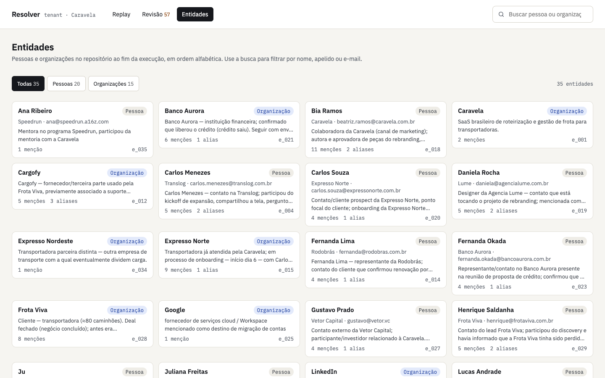
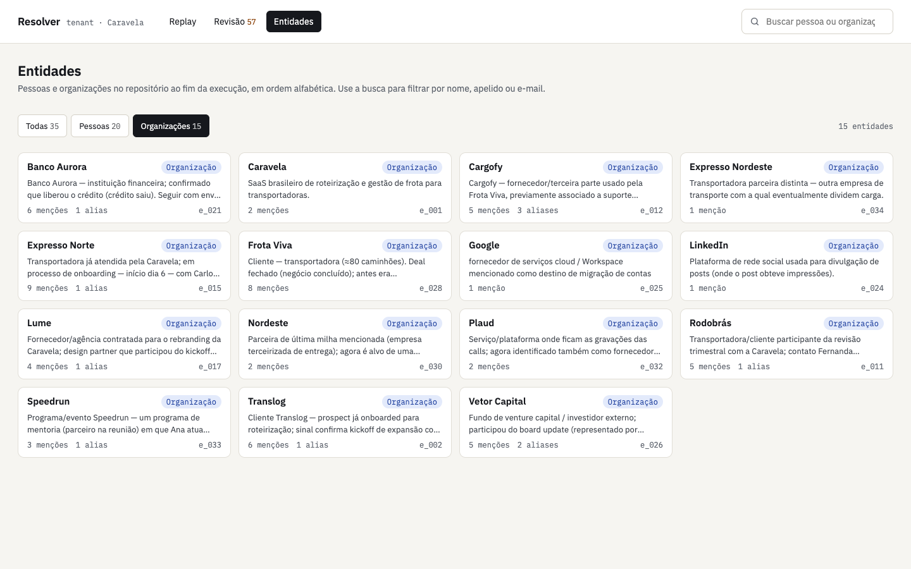
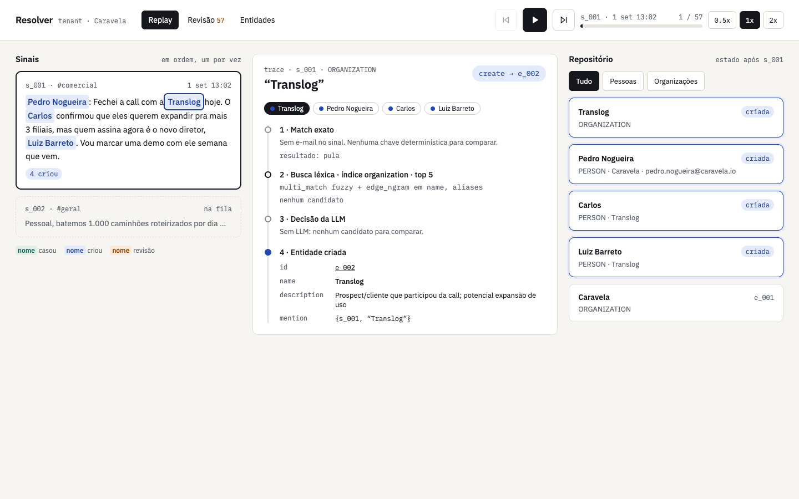
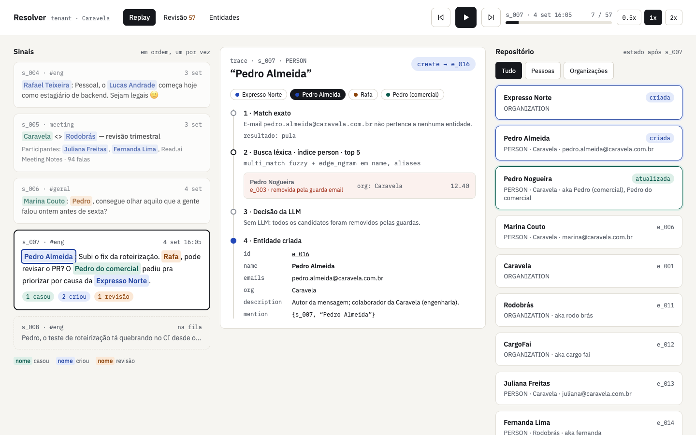
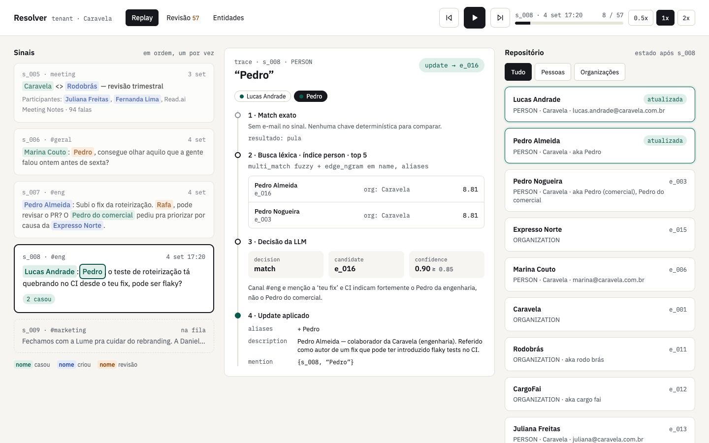
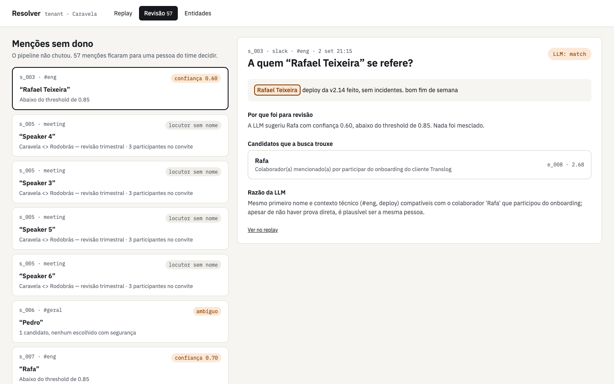
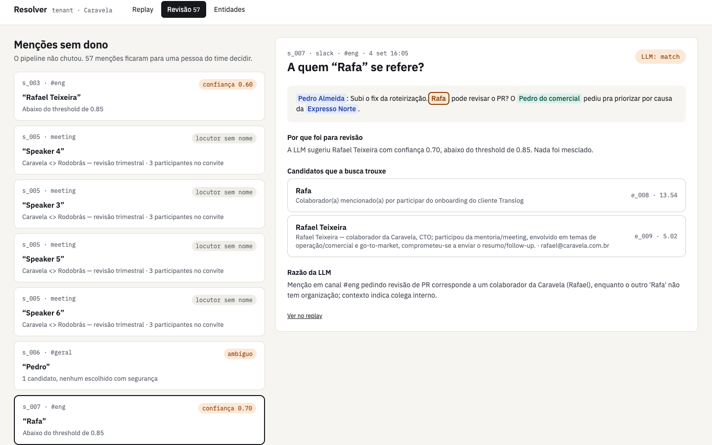
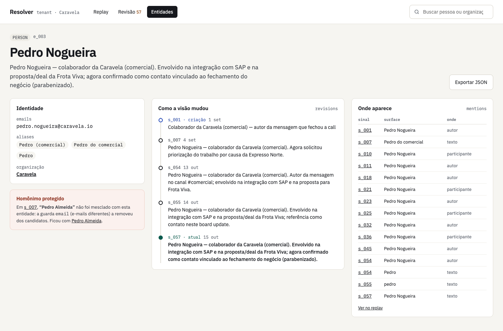
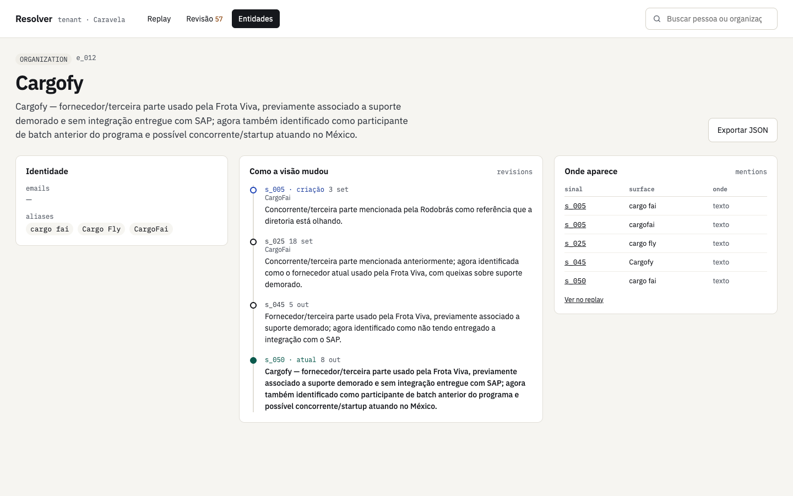
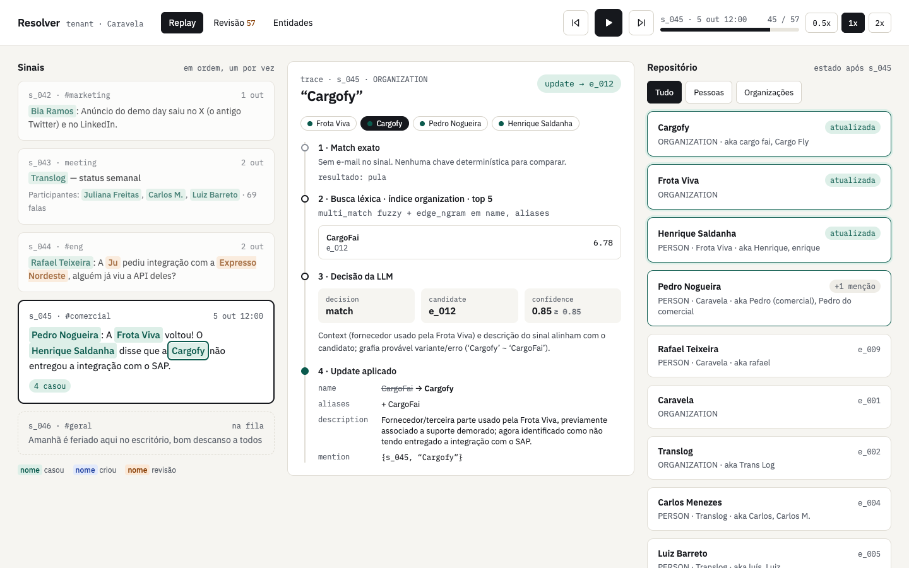

# Demo storyboard

A guided tour of the UI on the sample run, in the order you would record a demo video. Each
scene says what is on screen, what to point at, and what it proves about the pipeline.

To follow along: `make up install run`, then `make api` and `make ui`, and open
<http://localhost:5173>. The screenshots are from the run in `out/` (35 entities, 57
review items).

- [Scene 1 · The result: the entity repository](#scene-1--the-result-the-entity-repository)
- [Scene 2 · Filter by kind](#scene-2--filter-by-kind)
- [Scene 3 · Replay from the first signal](#scene-3--replay-from-the-first-signal)
- [Scene 4 · s_005, a meeting with unnamed speakers](#scene-4--s_005-a-meeting-with-unnamed-speakers)
- [Scene 5 · s_006, a first name that is not enough](#scene-5--s_006-a-first-name-that-is-not-enough)
- [Scene 6 · s_007, the guard keeps two Pedros apart](#scene-6--s_007-the-guard-keeps-two-pedros-apart)
- [Scene 7 · s_008, the same first name, now resolved](#scene-7--s_008-the-same-first-name-now-resolved)
- [Scene 8 · The review report](#scene-8--the-review-report)
- [Scene 9 · One review item in detail](#scene-9--one-review-item-in-detail)
- [Scene 10 · An entity page: Pedro Nogueira](#scene-10--an-entity-page-pedro-nogueira)
- [Scene 11 · An organization named after a transcription error](#scene-11--an-organization-named-after-a-transcription-error)
- [Scene 12 · The rename, in the replay](#scene-12--the-rename-in-the-replay)

The screens are **Entities** (the repository after the last signal and one page per entity),
**Replay** (the run, signal by signal, with the decision trace) and **Revisão** (the mentions
the pipeline did not attribute). All of them are read-only.

---

## Scene 1 · The result: the entity repository

`/entities`

**On screen.** Every person and organization in the repository after the last signal, in
alphabetical order. Each card has the kind, the person's organization and email, the current
description, and how many mentions and aliases the entity collected.

**Point at.**
- "Carlos Menezes" (Translog) and "Carlos Souza" (Expresso Norte): same first name, two
  entities.
- "Fernanda Lima" (Rodobrás) and "Fernanda Okada" (Banco Aurora): the same.
- "Expresso Nordeste" and "Expresso Norte": two companies with almost the same name, kept
  apart.

**Narration.** "57 signals in, 35 entities out. Before anything else, the homonyms are
apart: that is the error this pipeline is built to avoid."

## Scene 2 · Filter by kind

`/entities?kind=ORGANIZATION`

**On screen.** The filter (Todas 35, Pessoas 20, Organizações 15) restricted to
organizations. The filter is in the URL and combines with the search box in the header
(name, alias or email).

**Point at.** "Cargofy" with the aliases "cargo fai" and "Cargo Fly": misheard forms from
transcripts, attached to the right company (scenes 11 and 12 show how).

## Scene 3 · Replay from the first signal

`/replay?s=s_001`

**On screen.** Three columns:
1. **Signals**, in arrival order. Each mention is colored by what happened to it: green, it
   matched an entity that already existed; blue, it created a new one; orange, it went to
   review.
2. **Decision trace** of one mention, in four steps: exact match, lexical search with the
   candidates and their scores, the LLM decision, and the change applied.
3. **Repository** as it stands right after this signal, rebuilt in the browser from the
   trace. Entities touched by the signal are highlighted (criada, atualizada, +1 menção).

**Point at.** The controls in the header: previous, play/pause, next, and the speed (0.5x,
1x, 2x). Pressing play steps through the run like the live stream it simulates.

**Narration.** "The first Slack message creates Pedro Nogueira, Translog, Carlos and Luiz
Barreto. The repository starts with only the tenant, Caravela, seeded before the first
signal."

## Scene 4 · s_005, a meeting with unnamed speakers

`/replay?s=s_005`

**Input.** A 94-utterance transcript. The invite lists Juliana Freitas, Fernanda Lima and
the "Read.ai Meeting Notes" bot; several utterances come from "Speaker 3" to "Speaker 6".

| Mention | Source | What happened |
| --- | --- | --- |
| Read.ai Meeting Notes | participant | ignored: a bot |
| Speaker 3, 4, 5, 6 | speaker | **review**, "locutor sem nome": never guessed |
| Caravela | text | **updated** e_001 by exact domain match, no search, no LLM |
| Rodobrás, "rodo brás" | text | **created** e_011, the misheard form kept as an alias |
| "cargo fai" | text | **created** e_012 as "CargoFai" (renamed in scene 12) |
| Juliana Freitas, Fernanda Lima | participant | **created** e_013 and e_014, with their emails |
| "fernanda" | text | **updated** e_014: LLM `match` at 0.95 |

**Point at.** The trace opens on the most telling event of the signal, here an unnamed
speaker: no exact match, no search, no LLM, straight to review. Organizations are resolved
before people, so Rodobrás exists when Fernanda Lima is linked to it.

## Scene 5 · s_006, a first name that is not enough

`/replay?s=s_006`

**Input.** Marina Couto in #geral: "Pedro, consegue olhar aquilo que a gente falou ontem
antes de sexta?"

| Mention | Source | What happened |
| --- | --- | --- |
| Marina Couto | author | **updated** e_006 by exact email match |
| Pedro | text | **review**: LLM `ambiguous` at 0.60 |

**Point at.** Only one Pedro exists at this point, and the search returns him. The LLM still
answers ambiguous: a bare first name in a general channel gives nothing to decide on.

**Narration.** "It would be easy to attach this to the only Pedro we know. The next signal
shows why we didn't."

## Scene 6 · s_007, the guard keeps two Pedros apart

`/replay?s=s_007`, event "Pedro Almeida"

**Input.** Pedro Almeida in #eng: "Subi o fix da roteirização. Rafa, pode revisar o PR? O
Pedro do comercial pediu pra priorizar por causa da Expresso Norte."

| Mention | Source | What happened |
| --- | --- | --- |
| Expresso Norte | text | **created** e_015 |
| Pedro Almeida | author | **created** e_016: the only candidate was **removed by the email guard** |
| Rafa | text | **review**: LLM `match` with Rafael Teixeira at 0.70, below 0.85 |
| Pedro do comercial | text | **updated** Pedro Nogueira: LLM `match` at 0.90 |

**Point at.** Step 2 of the trace: Pedro Nogueira struck through, "removida pela guarda
email". The two have different emails, so the candidate is dropped before the LLM is asked,
and step 3 says so. In the same message, "Pedro do comercial" goes to Nogueira because the
role is in the text.

## Scene 7 · s_008, the same first name, now resolved

`/replay?s=s_008`, event "Pedro"

**Input.** Lucas Andrade in #eng: "Pedro, o teste de roteirização tá quebrando no CI desde
o teu fix, pode ser flaky?"

| Mention | Source | What happened |
| --- | --- | --- |
| Lucas Andrade | author | **updated** e_010: LLM `match` at 0.90, email added |
| Pedro | text | **updated** e_016 Pedro Almeida: LLM `match` at 0.90 |

**Point at.** Both Pedros come back with the same search score, 8.81: the name alone cannot
decide. The LLM picks the engineer from "#eng", "teu fix" and "CI". Lucas Andrade had been
created at s_004 from a mention without email; as the author here, he is matched and his
email is attached instead of creating a duplicate.

**Narration.** "Same word as in s_006, opposite outcome, and both are right: what changed is
the evidence, not the name."

## Scene 8 · The review report

`/review`

**On screen.** Every mention the pipeline did not attribute (57 in this run), in signal
order. Each item shows its reason:
- **locutor sem nome**: a "Speaker N" in a transcript (42 of them);
- **ambíguo**: the LLM could not tell between the candidates;
- **confiança 0.xx**: the LLM proposed a match below the 0.85 threshold;
- **sem âncora**: a bare first name with no candidate, no email, organization or role.

**Narration.** "This is the price of never merging two people by mistake: a list of
mentions waiting for a human. It is a report, not a work queue; manual review is in the
backlog."

## Scene 9 · One review item in detail

`/review`, item "Rafa" (s_007)

**On screen.** The signal with the mention highlighted, why it went to review ("A LLM
sugeriu Rafael Teixeira com confiança 0.70, abaixo do threshold de 0.85"), the candidates the
search returned with their scores, and the LLM's reason. "Ver no replay" jumps to the signal.

**Point at.** Two candidates: "Rafa" (e_008), created earlier from the nickname alone, and
Rafael Teixeira (e_009). They are very likely the same person, and the LLM leans the right
way, but with low confidence. Keeping two records is the cheap error; a human can join them
later.

## Scene 10 · An entity page: Pedro Nogueira

`/entities/e_003`

**On screen.**
- **Identidade:** email, aliases ("Pedro do comercial", "Pedro") and organization.
- **Homônimo protegido:** at s_007, "Pedro Almeida" was not merged into this entity because
  the email guard removed it from the candidates. Shown only when a guard actually fired.
- **Como a visão mudou:** one revision per signal that changed the name or the description,
  from the creation at s_001 to the current one at s_057.
- **Onde aparece:** every mention, with the exact surface and where it came from (author,
  participant, speaker or text). Each signal links back to the replay.
- **Exportar JSON** downloads the entity as stored.

**Narration.** "The description is not static: it is rewritten when a signal brings
something new, and every version is kept."

## Scene 11 · An organization named after a transcription error

`/entities/e_012`

**On screen.** Cargofy, with "cargo fai", "Cargo Fly" and "CargoFai" as aliases. The
revisions show that the entity was born at s_005 as "CargoFai", from a misheard transcript.

## Scene 12 · The rename, in the replay

`/replay?s=s_045`, event "Cargofy"

**Point at.** Step 4 of the trace: `name CargoFai -> Cargofy`, with "CargoFai" added as an
alias. When a correctly spelled mention matches an organization, the decision also returns
the right spelling, and it is accepted only if it is one of the forms already seen (the
name, an alias, or the surface of the mention). The LLM can fix a misheard name; it cannot
invent one.

**Narration.** "Same idea as the guards: the model proposes, the rules decide what is
allowed to change."

---

The rules behind each scene are in [decisions.md](decisions.md); what is left out is in
[backlog.md](backlog.md).
