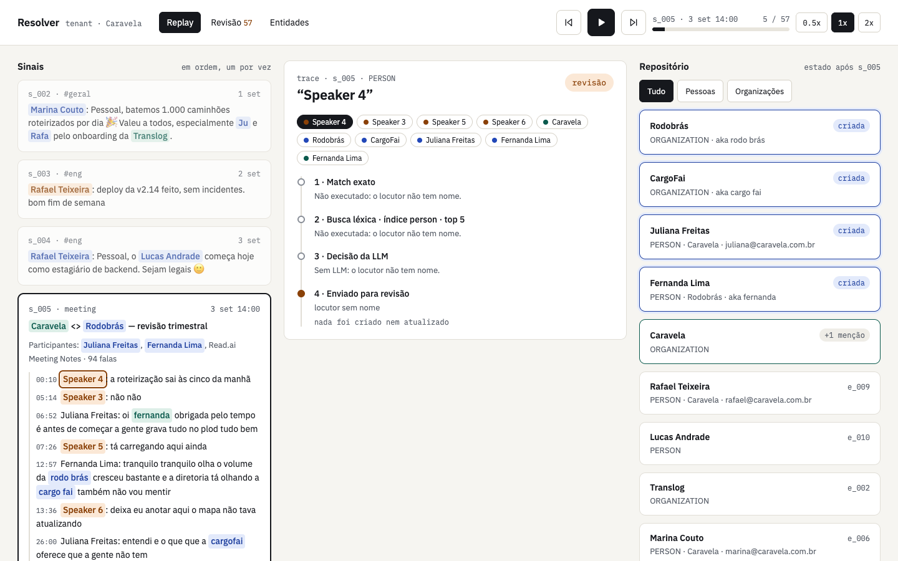
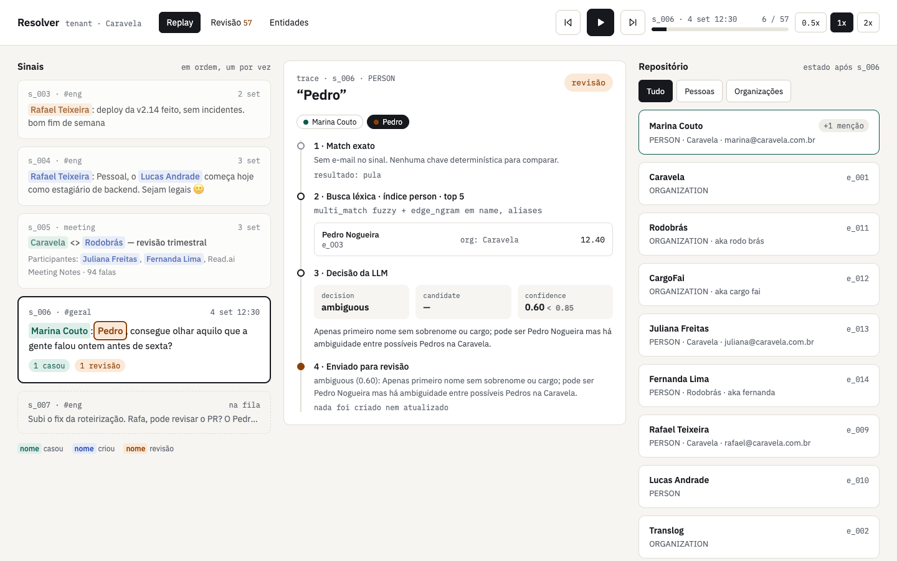

# Walkthrough: four signals in a row

What the pipeline captured and changed in signals `s_005` to `s_008` of the sample run, as
shown by the replay UI (`make api`, `make ui`, then `/replay?s=s_005`). Together they show
a meeting with unnamed speakers, an ambiguous first name, a guard keeping two people apart,
and the same first name resolved correctly one signal later.

Each screenshot has three columns: the signals in order (mentions colored by outcome:
green matched an existing entity, blue created one, orange went to review), the decision
trace of one mention, and the repository as it stands right after the signal.

## s_005 · meeting "Caravela <> Rodobrás — revisão trimestral"

**Input.** A 94-utterance transcript. The invite lists Juliana Freitas
(`juliana@caravela.com.br`), Fernanda Lima (`fernanda@rodobras.com.br`) and the
"Read.ai Meeting Notes" bot. Several utterances come from "Speaker 3" to "Speaker 6".

**Captured.**

| Mention | Source | What happened |
| --- | --- | --- |
| Read.ai Meeting Notes | participant | ignored: a bot (no email, "notes" in the name) |
| Speaker 3, 4, 5, 6 | speaker | **review**, "locutor sem nome": never guessed |
| Caravela | text | **updated** e_001 by exact domain match, no search, no LLM |
| Rodobrás, "rodo brás" | text | **created** e_011; the misheard form is kept as an alias |
| "cargo fai", "cargofai" | text | **created** e_012 as "CargoFai"; renamed to "Cargofy" at s_045 (see below) |
| Juliana Freitas | participant | **created** e_013 with her email; organization Caravela from the domain |
| Fernanda Lima | participant | **created** e_014 with her email |
| "fernanda" | text | **updated** e_014: one candidate, LLM `match` at 0.95 |

**Why it matters.** Organizations are resolved before people, so Rodobrás exists when
Fernanda Lima is processed. The lower-case "fernanda" in the transcript is stored as a
mention with its exact text. "CargoFai" shows the cost of naming an organization after its
first, misheard mention; at s_045 a correct "Cargofy" mention matches it and the decision
picks the right spelling among the known forms, keeping "CargoFai" as an alias.

## s_006 · Slack #geral, by Marina Couto

**Input.** "Pedro, consegue olhar aquilo que a gente falou ontem antes de sexta?"

**Captured.**

| Mention | Source | What happened |
| --- | --- | --- |
| Marina Couto | author | **updated** e_006 by exact email match |
| Pedro | text | **review**: LLM `ambiguous` at 0.60 |

**Why it matters.** At this point only one Pedro exists (Pedro Nogueira, e_003), and the
search returns him. The LLM still answers ambiguous: a bare first name in a general channel
gives nothing to decide on. The pipeline does not guess, and the next signal proves it
right: a second Pedro appears.

## s_007 · Slack #eng, by Pedro Almeida

**Input.** "Subi o fix da roteirização. Rafa, pode revisar o PR? O Pedro do comercial pediu
pra priorizar por causa da Expresso Norte."

**Captured.**

| Mention | Source | What happened |
| --- | --- | --- |
| Expresso Norte | text | **created** e_015 |
| Pedro Almeida | author | **created** e_016: the only candidate, Pedro Nogueira, was **removed by the email guard** |
| Rafa | text | **review**: LLM `match` with Rafael Teixeira at 0.70, below the 0.85 threshold |
| Pedro do comercial | text | **updated** e_003 Pedro Nogueira: LLM `match` at 0.90 ("do comercial") |

**Why it matters.** This is the guard working on real data. Pedro Almeida arrives with
`pedro.almeida@caravela.com.br`; the search finds Pedro Nogueira (score 12.4), who has a
different email, so the candidate is dropped before the LLM is asked and a new entity is
created. In the same signal, "Pedro do comercial" is attributed to Nogueira because the
role is in the text. "Rafa" shows the conservative threshold: the LLM pointed to the right
person, with low confidence, and the mention went to review instead of being merged.

## s_008 · Slack #eng, by Lucas Andrade

**Input.** "Pedro, o teste de roteirização tá quebrando no CI desde o teu fix, pode ser
flaky?"

**Captured.**

| Mention | Source | What happened |
| --- | --- | --- |
| Lucas Andrade | author | **updated** e_010: LLM `match` at 0.90; his email is added |
| Pedro | text | **updated** e_016 Pedro Almeida: LLM `match` at 0.90 |

**Why it matters.** Two signals after the ambiguous "Pedro", the same bare first name is
resolved, because the context now separates the two: both Pedros come back with the same
search score (8.81), and the LLM picks the engineer from "#eng", "teu fix" and "CI". The
name alone never decides. Lucas Andrade was created at s_004 from a mention without email;
here he is the author, so the LLM confirms the match and the email is attached to the
existing entity instead of creating a duplicate.

## What the four signals show

- Unnamed speakers and bots never become entities.
- An exact email or domain resolves without search or LLM.
- A first name alone goes to review until the context separates the candidates.
- A guard removes a candidate before the LLM sees it, so two people with the same first
  name cannot be merged.
- Below 0.85 a match goes to review, even when the LLM points to the right person.

The rules behind each step are in [decisions.md](decisions.md).
